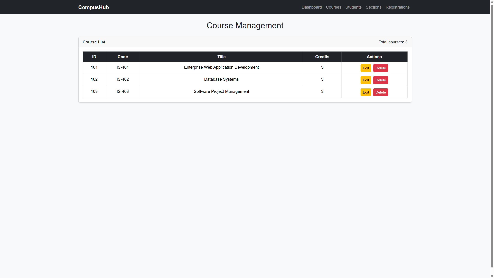
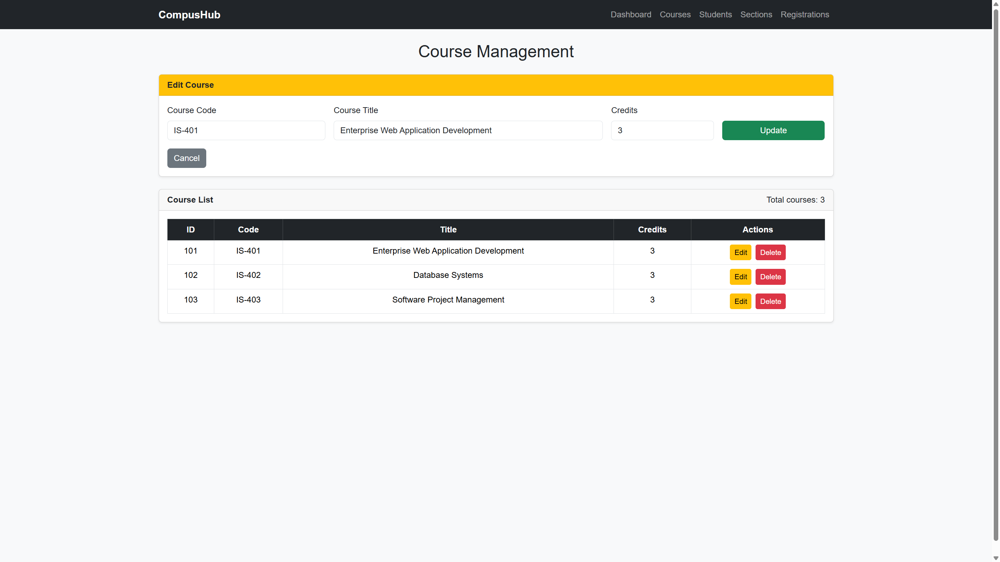
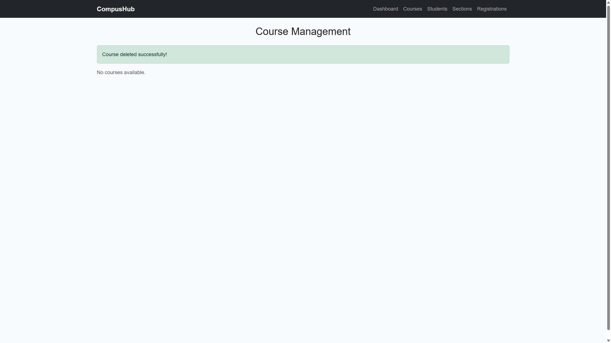
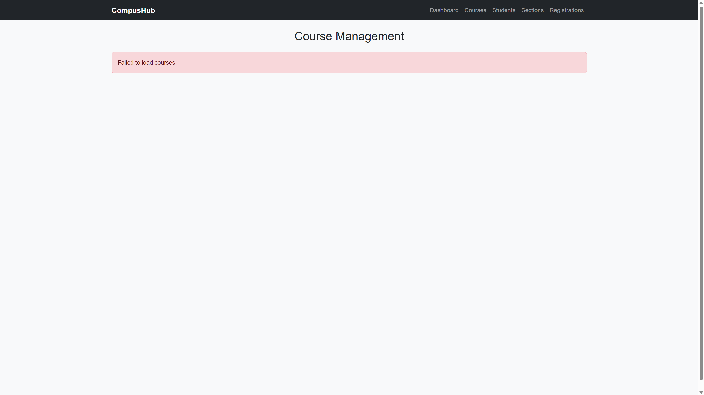

# CompusHub — Course Management: Edit and Delete

Enterprise Web Applications, Faculty of Computer Science, Kabul University.

This React application lists courses from the existing Spring Boot API and lets a user edit or delete a course. It does not replace the backend.

## Objectives

- Load courses with `GET /api/v1/courses`.
- Show each course in a Bootstrap table with an Actions column.
- Load the selected course into an edit form and save it with `PUT /api/v1/courses/{id}`.
- Ask for confirmation, then delete a course with `DELETE /api/v1/courses/{id}`.
- Refresh the list and show a success message only after the API accepts the change.
- Show loading, empty, validation, and API error states.
- Avoid `course.code.trim is not a function` when a course code is not already a string.

## Technologies

- React 18 and JavaScript
- Vite
- Bootstrap 5
- React Router
- Axios
- Existing Spring Boot REST API on port 8080

## Features

- Course table with ID, code, title, credits, and the number of courses.
- Edit form filled with the selected course.
- Update and Cancel actions.
- Delete confirmation through the browser confirm dialog.
- Success and error alerts.
- Loading text while the first request is in progress.
- “No courses available.” only after a successful request returns an empty list.

## Prerequisites

- Node.js and npm
- The existing CompusHub Spring Boot application, running at `http://localhost:8080`
- The course controller must already expose:
  - `GET /api/v1/courses`
  - `PUT /api/v1/courses/{id}`
  - `DELETE /api/v1/courses/{id}`
- CORS must allow the React origin `http://localhost:5173`, including `PUT`, `DELETE`, and `OPTIONS`
- Java 17 or newer for the Spring Boot project from class

The Spring Boot project is separate from this React folder. This repository does not contain the backend source.

## Setup

Open a terminal in this `compushub-ui` folder.

```powershell
npm install
```

If the folder path contains parentheses, such as `compushub-ui-lab4 (1)`, rename the folder first. Parentheses can stop `npm install` and `npm run dev` on Windows.

## Run commands

Start the Spring Boot backend first, from its own project, so it listens on port 8080. In IntelliJ, run the application main class. The API base URL is:

```text
http://localhost:8080/api/v1/courses
```

Then start the React app:

```powershell
npm run dev
```

Open the address Vite prints, normally:

```text
http://localhost:5173/courses
```

If `npm run dev` fails because of parentheses in the folder name, use:

```powershell
node .\node_modules\vite\bin\vite.js
```

## API endpoints used by this lab

| Method | URL | Body | Success |
| --- | --- | --- | --- |
| GET | `/api/v1/courses` | none | 200 and a JSON array |
| PUT | `/api/v1/courses/{id}` | `{ "code", "title", "credits" }` | 200 and the updated course |
| DELETE | `/api/v1/courses/{id}` | none | 204 No Content |

The React code sends `code` and `title` as trimmed strings and `credits` as a number. It does not send the id in the JSON body. The id stays in the URL.

Example update:

```http
PUT http://localhost:8080/api/v1/courses/101
Content-Type: application/json

{
  "code": "IS-401",
  "title": "Enterprise Web Applications",
  "credits": 3
}
```

## Testing steps

1. Start Spring Boot and confirm `GET http://localhost:8080/api/v1/courses` returns a JSON array.
2. Start the React app and open `/courses`.
3. Confirm the table shows the backend courses, not a hardcoded list.
4. Click Edit on one course and check that code, title, and credits fill the form.
5. Change the title and click Update. The success alert appears and the table shows the new title.
6. Refresh the browser. The new title is still there.
7. Click Delete and choose Cancel. The course remains.
8. Click Delete and choose OK. The course disappears and the success alert appears.
9. Stop Spring Boot and refresh `/courses`. The page shows “Failed to load courses.”

## Project structure

```text
compushub-ui/
|-- docs/screenshots/
|-- src/
|   |-- components/
|   |   |-- Courses.jsx      course page: list, edit, and delete
|   |   |-- Layout.jsx
|   |   |-- Navbar.jsx
|   |   `-- ...
|   |-- services/
|   |   `-- courseApi.js     GET, PUT, and DELETE calls
|   |-- App.jsx
|   `-- main.jsx
|-- package.json
`-- vite.config.js
```

`src/services/courseApi.js` holds the HTTP calls. `src/components/Courses.jsx` holds the form state and the table.

## Screenshots

These pictures were captured from the running React page.

Course list:



Edit form loaded with the selected course:



Empty list after the last course is deleted:



Error shown when the API is not running:



## What to say in the demonstration

- `useEffect` loads the courses once when the page opens.
- `editingId` is `null` until Edit is clicked. That is how the form stays hidden.
- `String(course.code ?? "").trim()` fixes the trim error. A number has no `trim` method, so the value is converted to a string first.
- Update calls `updateCourse`, then `loadCourses`. The success message is shown only after the PUT succeeds.
- Delete calls `window.confirm`. Cancel returns immediately and does not call the API.
